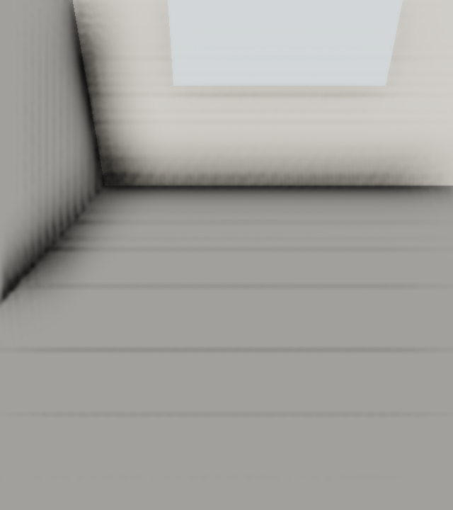
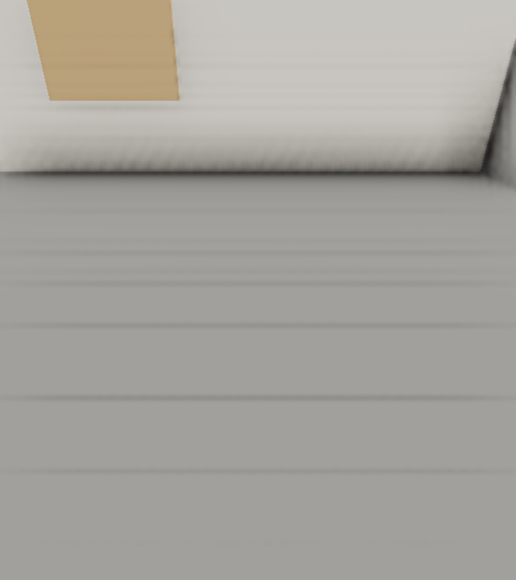
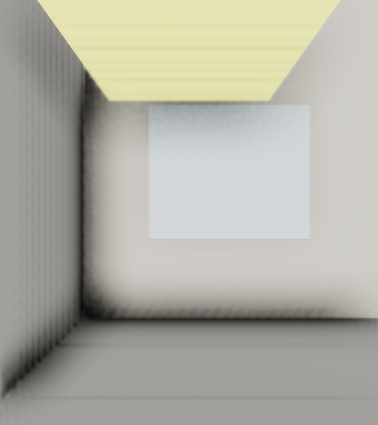

# Chapitre 6 — Exercice 6 : Le cône du mauvais ordre

## Fichiers

- [cone.cpp](cone.cpp)
- [hauteurs.txt](hauteurs.txt)
- [cone.txt](cone.txt)
- [Salle de départ](../main.cpp)
- [bon-90.png](bon-90.png)
- [mauvais-0.png](mauvais-0.png)
- [mauvais-90.png](mauvais-90.png)

## Hauteurs calculées

Pour un tangage de 30° et les cinq lacets demandés, l’exécutable donne :

| Lacet | Ordre correct | Ordre inversé |
|---:|---:|---:|
| 0° | 30,00° | 30,00° |
| 45° | 30,00° | 20,70° |
| 90° | 30,00° | 0,00° |
| 135° | 30,00° | −20,70° |
| 180° | 30,00° | −30,00° |

Les valeurs sont des calculs de vecteurs par le programme, et non des mesures tirées d’une capture d’écran.

## Réponses

- Avec le bon ordre, le regard conserve une hauteur de 30° lorsque le lacet varie.
- Avec l’ordre inversé, la hauteur dépend du lacet ; elle passe de 30° à −30° et le regard décrit un cône.
- L’erreur vient du fait que le tangage est appliqué autour de l’axe monde avant le lacet au lieu de suivre l’orientation de la tête.

Les captures ci-dessus proviennent de la scène réelle Salle en rendu R3D/OpenGL, produites avec les raccourcis `1`, `2` et `3`. Chaque image est extraite de la zone cliente en 640 × 720 pixels.

