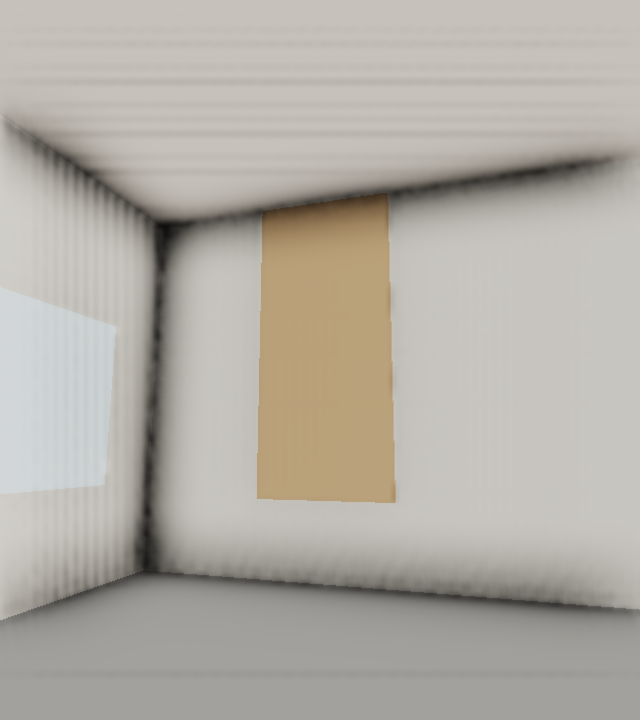
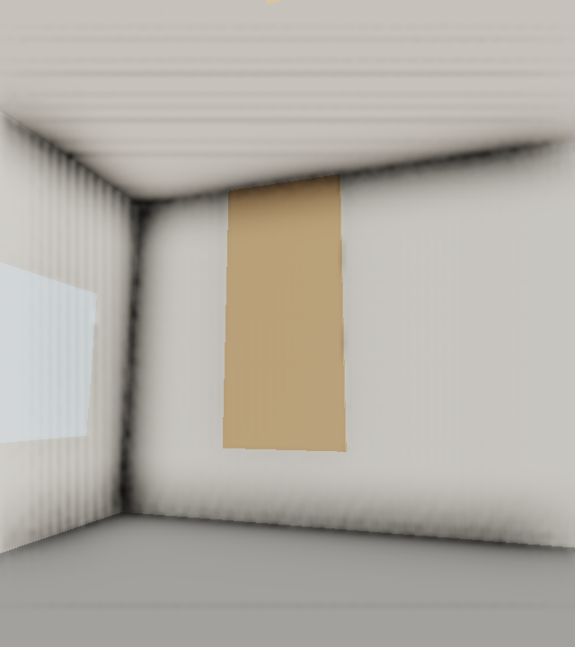
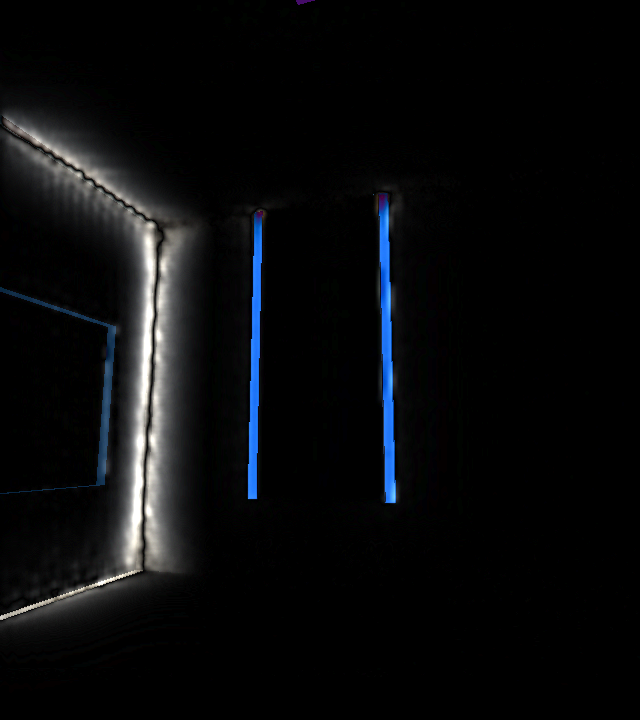
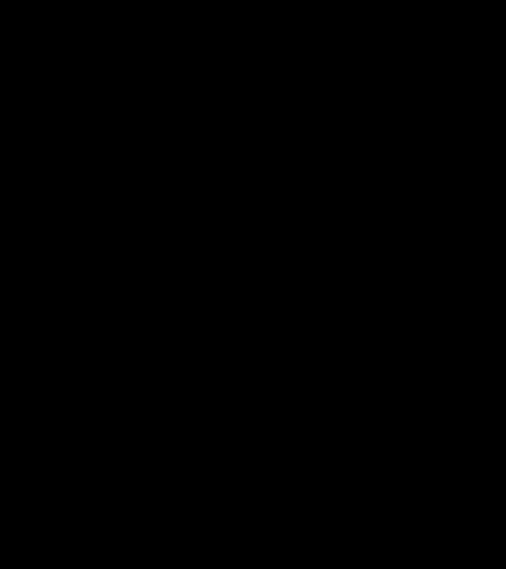

# Chapitre 6 — Exercice 9 : Les deux images, et l’image noire

## Fichiers

- [deux-yeux.cpp](deux-yeux.cpp)
- [oeil-gauche.png](oeil-gauche.png)
- [oeil-droit.png](oeil-droit.png)
- [difference.png](difference.png)
- [oeil-gauche-sans-decalage.png](oeil-gauche-sans-decalage.png)
- [oeil-droit-sans-decalage.png](oeil-droit-sans-decalage.png)
- [difference-vue-oubliee.png](difference-vue-oubliee.png)
- [difference.txt](difference.txt)
- [reponse.txt](reponse.txt)
- [Salle de départ](../main.cpp)

## Méthode de comparaison

La fonction de comparaison du programme attend deux buffers RGBA de 640 × 720 pixels synchronisés. Pour chaque pixel, elle calcule le plus grand écart entre les canaux, compte les pixels dont cet écart dépasse 1, calcule l’écart maximal et produit les canaux de différence `min(255, 4 × |écart|)`.

Les captures proviennent de la Salle R3D/OpenGL et font 640 × 720 pixels. Le raccourci `4` décale la caméra vers l’œil gauche de 31,5 mm, `5` vers l’œil droit de 31,5 mm et `6` montre la vue fautive sans décalage IPD. La scène est statique; les images ont été capturées séquentiellement, pas depuis le même frame. Les cartes de différence sont calculées pixel par pixel à partir des captures et leurs statistiques sont dans [difference.txt](difference.txt).

| Vue | Capture |
|---|---|
| Œil gauche, IPD appliqué |  |
| Œil droit, IPD appliqué |  |
| Différence entre les deux yeux |  |
| Deux yeux avec le décalage oublié | [Vue gauche](oeil-gauche-sans-decalage.png) / [vue droite](oeil-droit-sans-decalage.png) |
| Différence lorsque l’offset est oublié |  |

## Réponses

- **Où attendre le plus d’écart :** les contours et les bords des objets, où la parallaxe apparente entraîne des déplacements visibles entre les deux vues. La carte correcte compte 86 817 pixels différents au-delà du seuil, avec un écart maximal de 91.
- **Pourquoi deux images stéréo diffèrent :** les centres de projection sont décalés de part et d’autre de la tête ; les occultations et les positions horizontales des surfaces changent selon la profondeur.
- **Signification de l’image noire :** les deux caméras placées au centre sans offset rendent ici exactement la même scène ; la carte dédiée compte donc zéro pixel différent. Cette égalité n’est pas une preuve de bon rendu, d’où la vérification des deux captures sources.
- **Test de vue oubliée :** les deux images sans offset sont [oeil-gauche-sans-decalage.png](oeil-gauche-sans-decalage.png) et [oeil-droit-sans-decalage.png](oeil-droit-sans-decalage.png). Elles sont identiques, contrairement aux vues stéréo où 86 817 pixels dépassent le seuil.
